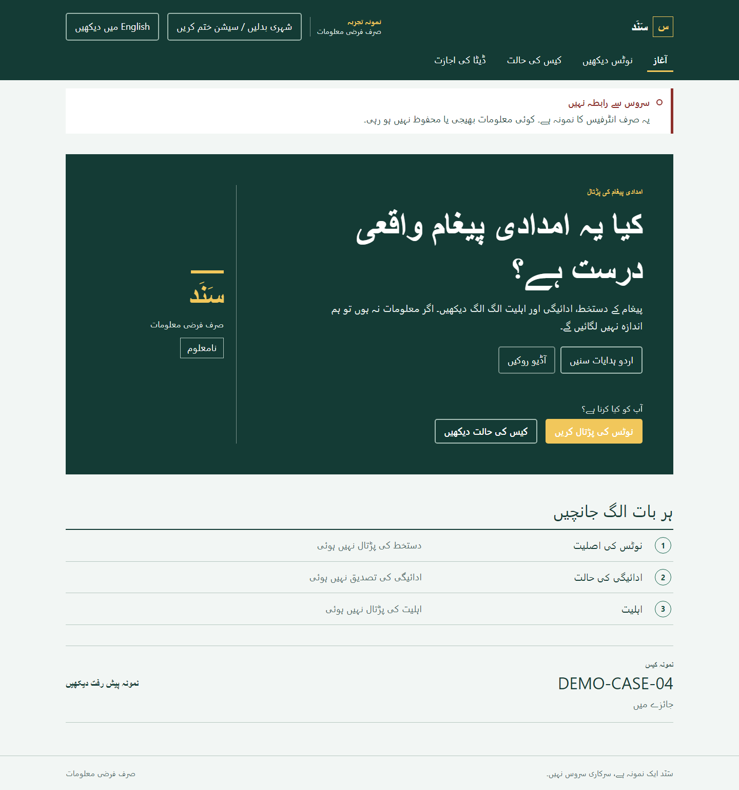
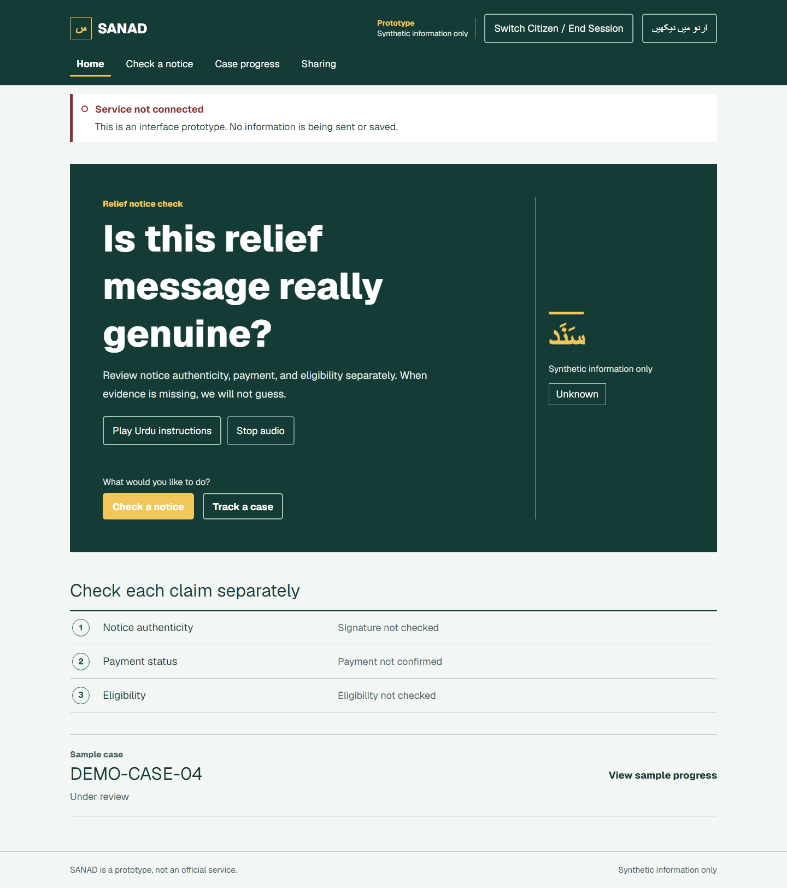
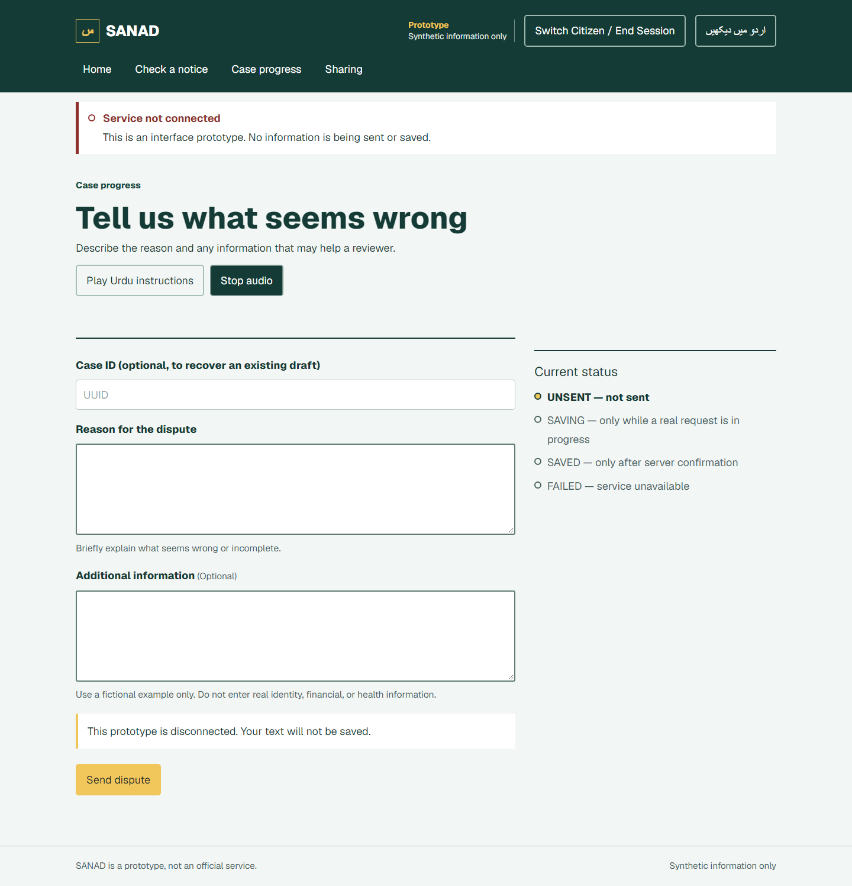
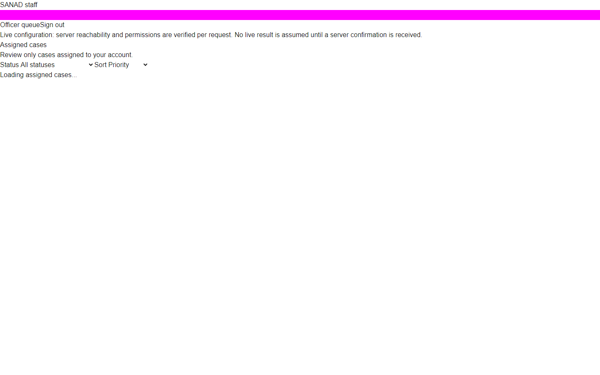

# SANAD

**A synthetic public-relief notice and dispute review prototype.** SANAD helps recipients understand what can be checked about a relief message, keep uncertain facts visible, and prepare a case for authorized human review. It is a hackathon prototype, not a government, identity, banking, or payment service. All demo data is synthetic.

[Open the deployed prototype](https://sanad-ai-eta.vercel.app/) · [OpenAPI documentation](https://sanad-ai-eta.vercel.app/api/v1/openapi) · [Technical guide](docs/SANAD_COMPLETE_GUIDE.md)

> **Hosted status:** the deployment is reachable, but the latest browser acceptance run did not complete a Citizen-to-staff case journey. The Citizen submission timed out, and the Officer and Admin pages stayed loading. Treat the hosted end-to-end workflow as **not verified**. See the [browser acceptance report](docs/testing/browser-acceptance.md) and [release audit](docs/final-release-audit.md).

## The problem and our approach

People may receive fake or altered public-relief messages, have incomplete records, or need help using a service with limited literacy or connectivity. A confident but wrong answer can cause harm.

SANAD models a safer review process: keep notice authenticity, expiry, recipient matching, payment, and eligibility as separate findings; preserve unknowns as unknown; collect versioned evidence; and require appropriate consent and human authority for case decisions. AI is advisory and cannot establish verified facts, approve money, or resolve a case.

## Main capabilities

The repository contains working backend capabilities and user-facing screens, but verification differs by feature. These are implementation claims, not a claim that every hosted workflow passed:

- Human sign-in, sessions, and logout for five database-assigned roles. The browser run observed successful sign-in and sign-out for each role.
- Server-side role, ownership, assignment, and consent checks around protected case operations.
- Versioned case drafts, append-only evidence and assessment history, and an Evidence Passport API.
- Consent grants scoped by case, recipient, purpose, actions, and duration, with revocation checks in the backend.
- A source-level Ed25519 signed-notice verifier and trusted-issuer registry reader. **End-to-end notice verification in the hosted app is not verified**; the Citizen notice screen currently reports that its service is disconnected and sends no notice.
- Versioned synthetic eligibility rules, Admin dispatch, Officer case workflows, audit metadata, scoped API keys, and generated OpenAPI documentation.

The [complete guide](docs/SANAD_COMPLETE_GUIDE.md) describes implementation boundaries and verification evidence. The [release audit](docs/final-release-audit.md) distinguishes module, local, and hosted results.

## User roles

| Role | Intended access |
| --- | --- |
| **Citizen** | Create and review a case, add evidence, and control case sharing. |
| **Helper** | Assist a Citizen only when that Citizen grants case-specific access. No dedicated Helper workspace is currently available. |
| **Officer** | Review assigned cases with valid department consent and perform guarded workflow actions. |
| **Admin** | Dispatch cases, manage assignments and priorities, and publish synthetic rules. Admin access does not grant private evidence access. |
| **Auditor** | Read permitted audit metadata; evidence trace requires a separate grant. No Auditor dashboard is currently available. |

## Screenshots

These are existing Chromium screenshots from the deployment tested on 22 November 2026. They document what rendered during that run; they do not prove a complete workflow. The staff pages below visibly remained in loading states.

### Citizen experience







### Staff pages as observed




See the full [screenshot index and acceptance report](docs/testing/browser-acceptance.md) for login, notice, Passport, consent, mobile, and session-reset screens.

## Architecture and stack

SANAD is one Next.js application. Its App Router pages, `/api/v1` route handlers, server-only domain services, and shared contracts live in the same TypeScript codebase. Route handlers call domain services; protected database work uses PostgreSQL transactions. Supabase Auth provides identity sessions, PostgreSQL stores application data, and Zod schemas define and validate API boundaries. The notice verifier uses `jose` for JWS handling.

- Next.js 16, React 19, and TypeScript
- PostgreSQL with Supabase Auth
- Zod 4 for request/response contracts
- `jose` for signed notice/JWS operations
- Generated OpenAPI 3.1 document
- Vercel deployment target

```text
Browser
  └─ Next.js pages and /api/v1
       └─ Server route handlers and domain services
            ├─ Supabase Auth session validation
            └─ PostgreSQL transactions, authorization, consent, audit, and history
```

## Local setup

Use a disposable development environment and synthetic data only. Never point setup commands at production. The [Demo Data Guide](docs/DEMO_DATA_GUIDE.md) has the full environment and safety requirements.

1. Install Node.js 22 or newer.
2. Install dependencies and create a local environment file from the example:

   ```bash
   npm ci
   cp .env.example .env.local
   ```

   On PowerShell, use `Copy-Item .env.example .env.local`.

3. Set the required development-only Supabase and PostgreSQL values in `.env.local`. Keep secret values private. Demo account passwords are supplied through private environment variables; this README intentionally publishes no account identifiers or credentials.
4. Apply migrations and seed synthetic accounts only against a confirmed disposable development database:

   ```bash
   npm run db:migrate
   npm run db:seed
   ```

5. Start the app:

   ```bash
   npm run dev
   ```

Open [http://localhost:3000](http://localhost:3000). Setup details and operating limits are in the [Operating Guide](docs/OPERATING_GUIDE.md) and [Demo Data Guide](docs/DEMO_DATA_GUIDE.md).

## API documentation

- **OpenAPI 3.1:** [`GET /api/v1/openapi`](https://sanad-ai-eta.vercel.app/api/v1/openapi) (served by the deployed app; private operations may be unavailable while hosted SQL-backed routes are failing).
- **API guide and operation details:** [SANAD Complete Guide — API](docs/SANAD_COMPLETE_GUIDE.md#18-rest-api-and-api-keys) and [Public API handoff](docs/b05-public-api.md).
- **Machine-readable route and schema source:** [`src/backend/openapi/operations.ts`](src/backend/openapi/operations.ts) and [`src/backend/openapi/document.ts`](src/backend/openapi/document.ts).

The OpenAPI document describes the source API contract; it does not establish that every operation is currently healthy on the hosted deployment.

## Guides and demo material

- [Complete technical guide](docs/SANAD_COMPLETE_GUIDE.md)
- [Operating guide](docs/OPERATING_GUIDE.md)
- [Demo data guide](docs/DEMO_DATA_GUIDE.md)
- [Judges' Q&A](docs/JUDGES_QA.md)
- [Browser acceptance report and screenshots](docs/testing/browser-acceptance.md)
- [Final release audit](docs/final-release-audit.md)
- **Demo video:** _Public demo video link will be added when the real URL is supplied._

## Limitations

- The release audit records a **failed release gate**. Do not present this deployment as a completed end-to-end service.
- In the 22 November browser run, Citizen dispute submission timed out without a Case ID; Officer and Admin pages stayed loading. The run recorded 8 grouped operations passing, 6 failing, and 12 not tested.
- The Citizen results screen shows sample findings, and the notice-check screen does not send input to a verifier. Live Passport and notice verification were not demonstrated in the browser.
- Helper and Auditor roles have no dedicated workspace. Shared-phone, weak-network, and low-literacy journeys are not verified end to end.
- No identity lookup API, payment lookup API, or general program-data lookup API is implemented. Payment status remains unknown; SANAD does not confirm a real identity, payment, or eligibility.
- Hosted AI was not demonstrated with a live provider. AI output is advisory and cannot replace cryptographic checks or human review.
- The browser report does not identify an immutable deployment commit. Its results apply to the observed URL and time only.

See [release audit](docs/final-release-audit.md), [browser acceptance](docs/testing/browser-acceptance.md), and [Judges' Q&A](docs/JUDGES_QA.md) for precise evidence and limits.

## Contributors

Contributors represented in the repository history: **Syed M. Taha**, **Aayan Mahmood**, **Ahad Memon**, and **mbilalansarii**.
